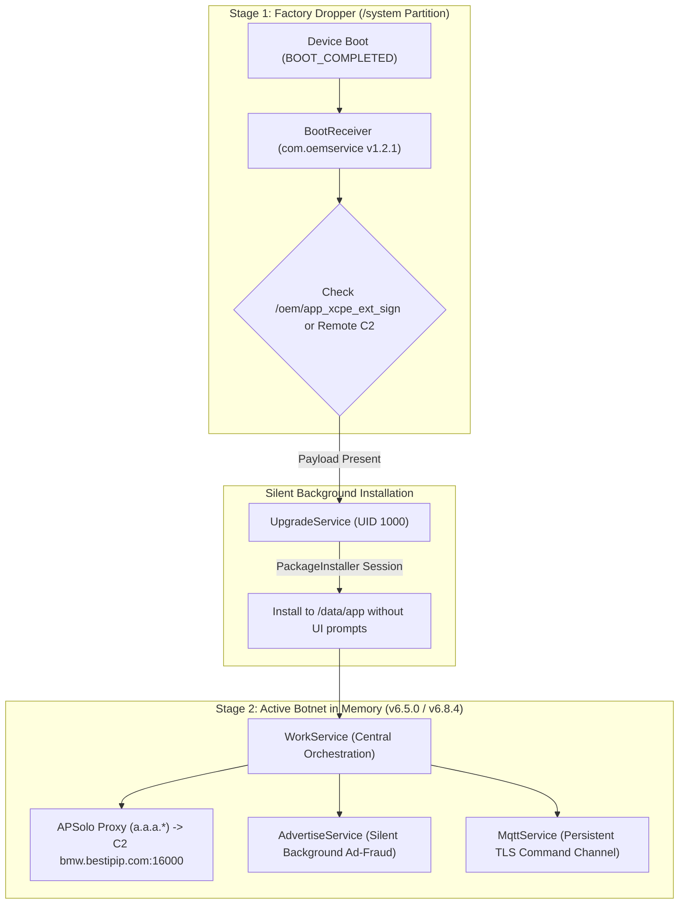

# Forensic Investigation Report: XCPE / BadBox Supply-Chain Malware (`com.oemservice`)

> **Language / Idioma:** English (Default) | [Para a versão em Português (PT-PT), consulte FORENSIC_XCPE_OEMSERVICE.md](FORENSIC_XCPE_OEMSERVICE.md)

---

## 1. Executive Summary
During security audits conducted on Android TV / Google TV devices running SkyworthDigital OEM firmware (notably MECOOL models and related white-label sticks/boxes), a persistent **Supply-Chain Attack** was discovered and analyzed.

This technical document details the static and behavioral reverse-engineering conducted on both the first-stage factory dropper (`app_xcpe_preset.apk` v1.2.1) and the second-stage botnet payload (`app_xcpe_ext_sign.apk` / `base.apk` v6.5.0). It demonstrates how a preinstalled system component running with elevated system privileges (`UID 1000`) silently acts as an unauthorized residential proxy relay, an ad-fraud engine, and an unnotified remote code execution vector.

---

## 2. Infection Architecture & Lifecycle

The malware operates via a modular **two-stage architecture** designed to evade factory QA tests and Google Play Protect static image scans:



### Stage 1: The Dormant Factory Dropper
* **ROM Location:** `/system/priv-app/app_xcpe_preset/app_xcpe_preset.apk`
* **Version:** `1.2.1` (Compiled for API 30)
* **Privilege Level:** `android:sharedUserId="android.uid.system"` (UID 1000)
* **Behavior:**
  * The manifest specifies no user-facing UI (`Theme.NoDisplay`).
  * On system startup, the high-priority broadcast receiver (`priority="1000"`) `android.intent.action.BOOT_COMPLETED` activates `x.cpe.receiver.BootReceiver`.
  * Decompiled source code from `BootReceiver.java` reveals deliberate local file checks inside the `/oem/` partition for packages named `com.oemservice`:
    ```java
    File file = new File("oem");
    if (file.exists() && file.listFiles() != null) {
        // Discovers preloaded payload at /oem/app_xcpe_ext_sign
        enterInstallService(context, file2);
    }
    ```
  * `UpgradeService.java` invokes the privileged `android.content.pm.PackageInstaller` API to silently install the payload as an update without user confirmation or screen alerts.

### Stage 2: The Active Botnet Payload
* **Source:** `/oem/app_xcpe_ext_sign` (or downloaded dynamically from C2).
* **Execution Path:** `/data/app/~~.../com.oemservice-.../base.apk`
* **Identified Versions:**
  * `v6.5.0.20230804.alpha` (VersionCode 43) — Recovered from MECOOL Stick `.160` (features hardcoded APSolo proxy).
  * `v6.8.9` (VersionCode 63) — Recovered from Mecool UHD Stick `.144` (features dynamic C2 `anyevonline.com`, remote shell execution, and screen-lock ransomware).
* **Target SDK:** API 28 (Android 9 Pie) — deliberately targeted to bypass modern background execution limits and privacy restrictions enforced in Android 10+.

---

## 3. In-Depth Analysis of Malicious Subsystems

Decompiling `app_xcpe_ext_sign` uncovered a full-featured botnet client consisting of over 7,000 files organized into distinct functional modules:

### 3.1. Covert Residential Proxyware (`APSolo Proxy` in v6.5.0)
* **Obfuscated Package:** `a.a.a.*`
* **Internal Log Tag:** `solo_ProxyLogger`
* **Hardcoded C2 / Relay Endpoint:**
  ```java
  package a.a.a;
  public class a {
      public static final String[] f0a = {"bmw.bestipip.com:16000"};
      public static long b = 24032810102L; // Build timestamp: 2024-03-28 10:10:02
  }
  ```
* **Technical Mechanism (`ae.java`, `c.java`):**
  * Implements a non-blocking asynchronous proxy server using Java NIO (`java.nio.channels.Selector`, 4096-byte `ByteBuffer`).
  * Establishes outbound reverse TCP tunnels to `bestipip.com:16000`.
  * Forwards inbound internet traffic from paying clients through the victim's residential connection, effectively monetizing home bandwidth on residential proxy markets (linked to BadBox / APSolo syndicates).

### 3.2. Dynamic C2 Infrastructure, Remote Shell & Ransomware (Evolution in v6.8.9)
In the latest variant (`v6.8.9`), the threat actor evolved beyond static proxy relays:
* **Primary C2 Host:** `extstb.anyevonline.com:8000` (`UrlBuilder.java` & `BuildUtils.java`).
* **Dynamic Provisioning Endpoints:**
  * `/router/config/mqtt`: Fetches dynamic MQTT broker connection details on the fly.
  * `/router/config/acs`: Remote management, diagnostics, and telemetry endpoints.
  * `/router/config/app`: Target lists for silent background APK installations.
* **Remote Arbitrary Shell Execution (`x.cpe.shell.*`):**
  * Bundles `CommandExecutor.java` and `ShellUtils.java` with commands like `execCommand("echo root", true)`, providing an interactive remote shell terminal (`sh` / `su`).
* **Screen Locking / Ransomware Mechanism (`LockedDialog`):**
  * Instantiates a system overlay dialog with `TYPE_APPLICATION_OVERLAY` / `TYPE_SYSTEM_ERROR` (Window Type 2038) marked `setCancelable(false)`:
    ```text
    "The device is locked, please contact the administrator"
    ```
  * Hijacks the entire screen, suppresses TV remote inputs, and displays a lock countdown.

### 3.3. Background Ad & Click Fraud (`AdvertiseService`)
* **Component:** `x.cpe.service.AdvertiseService`
* **Configuration:** `x.cpe.ServerConfig.java`
* **Key Parameters Discovered:**
  * `adUse`: Global toggle for ad injection;
  * `adDevourUse` / `adDevourCode = "lx102"`: Invisible webview engine that silently loads and consumes ads;
  * `adCode = 200101`: Affiliate campaign tracking ID;
  * `adBwmActive`: Bandwidth throttle mechanism to prevent network saturation and avoid alerting the user.
* **Anti-Crash Watchdog:**
  * Embeds an internal 10-second `ANRWatchDog`: if invisible ad rendering hangs the TV system, the service self-terminates to prevent Android from displaying the visible *"App isn't responding"* error dialog.

### 3.5. Evidence of Internal OEM Origin (MECOOL / Skyworth / Videostrong)
Decompilation of the payload sources provided irrefutable proof that this backdoor was an in-house engineering development created directly by the manufacturer:

1. **Proprietary MECOOL System Properties (`BuildUtils.java`):**
   ```java
   private static final String MECOOL_MODEL = "ro.mecool.device.model";

   public static String getManufacturer() {
       return "ext-MECOOL";
   }

   public static String getModelName() {
       String customModel = SystemPropUtils.getString(MECOOL_MODEL, "");
       LogUtils.i(String.format(Locale.ENGLISH, "%s: %s", MECOOL_MODEL, customModel));
       ...
   }
   ```
   * The malware explicitly queries the custom system property `ro.mecool.device.model` and hardcodes its telemetry identity as `"ext-MECOOL"`.

2. **Integration with SkyworthDigital Hardware Telemetry (`DeviceUtils.java`):**
   ```java
   public static String getCPUSerial() {
       ...
       if (isInValidChipId(cpuAddress)) {
           LogUtils.i("read chipid by ro.hardware.skyworthdigital.soc.chipid");
           cpuAddress = SystemPropUtils.getString(
               "ro.hardware.skyworthdigital.soc.chipid", 
               EnvironmentCompat.MEDIA_UNKNOWN
           );
       }
       return cpuAddress;
   }
   ```
   * The binary queries `ro.hardware.skyworthdigital.soc.chipid`, a private hardware property unique to SkyworthDigital board builds, to fingerprint and register infected units on the C2 server.

3. **Cryptographic System Platform Signing (`android.uid.system`):**
   * Running under `UID 1000` requires signing with the factory's private platform release key (`platform.pk8`). A third-party external actor could not have embedded or upgraded this APK with root-level system permissions without direct access to the OEM's firmware build infrastructure.

---

## 4. Documented Indicators of Compromise (IOCs)

| Type | Indicator | Function |
|---|---|---|
| **C2 Domain / Port** | `bmw.bestipip.com:16000` | Proxy relay & command server (v6.5) |
| **C2 Domains (v6.8.9)** | `extstb.anyevonline.com:8000`, `mcstb.anyevonline.com`, `router.anyevonline.com` | Dynamic HTTP/MQTT C2 discovered in Stick .144 |
| **Associated C2 Domains** | `rao.bestipip.com`, `song.bestipip.com`, `bestipip.com` | Secondary APSolo / XCPE botnet nodes |
| **Google GTIG Disrupted C2s** | `zorapslwsnic.com`, `cloudbrokerapi.xyz`, `floporin.com` | Global infrastructure dismantled by Google Cloud |
| **Android Package** | `com.oemservice`, `x.cpe` | Package identity for dropper and payload |
| **Factory ROM Path** | `/system/priv-app/app_xcpe_preset/app_xcpe_preset.apk` | Stage 1 Dropper (v1.2.1) |
| **OEM Partition Binary** | `/oem/app_xcpe_ext_sign` | Pre-staged Stage 2 Payload |
| **Execution UID** | `1000` (`android.uid.system`) | Shared system identity |

---

## 5. Alignment with Google Cloud Threat Intelligence (GTIG) Takedown

Our findings directly corroborate the international security advisory released by **Google Cloud Threat Intelligence (GTIG)** in partnership with Mandiant, HUMAN Security, and Japan's National Police Agency:
* **Official Report:** [Shutting the Door on the XCPE Botnet (Google Cloud)](https://cloud.google.com/blog/topics/threat-intelligence/shutting-the-door-on-the-xcpe-botnet)
* **Threat Actor Attribution:** Google officially concluded with high confidence that the XCPE backdoor was intentionally developed, preloaded, and monetized by Chinese ODM **Videostrong Technology Co.** (and associated ODM supply chains producing MECOOL hardware), impacting more than 1.3 million devices across 200 countries.
* **Google Enforcement:** Google revoked ecosystem certifications and banned Videostrong and its affiliates from manufacturing new devices with Google apps/GMS.
* **Local Validation:** Our reverse engineering of payload `v6.5.0` confirms the exact architecture documented by Google: reverse proxy tunneling (FRP/Java NIO), persistent MQTT command channels, background ad-fraud, and residential IP bandwidth theft routed via `bestipip.com:16000`.

---

## 5. Remediation & Defense

To permanently neutralize this supply-chain backdoor without voiding warranties or requiring bootloader unlocks:

1. **Freeze Backdoor Package via ADB:**
   ```bash
   adb shell pm disable-user --user 0 com.oemservice
   ```
   * *Effect:* Instantly kills active memory processes (`WorkService`, `NetworkService`, `AccessService`) and uninstalls the `/data/app` payload, freezing the factory base component (`disabled-user`).

2. **Cancel Persistence Jobs:**
   ```bash
   adb shell cmd jobscheduler cancel -u 0 com.oemservice
   ```

3. **Enforce Private DNS over TLS (DoT):**
   * Configure OS-level DNS filtering to block malicious C2 resolution:
     ```bash
     adb shell settings put global private_dns_mode hostname
     adb shell settings put global private_dns_specifier security.cloudflare-dns.com
     ```
   * Ensures that even if the app were re-enabled, C2 resolution to `bestipip.com` fails deterministically at the DNS layer.
