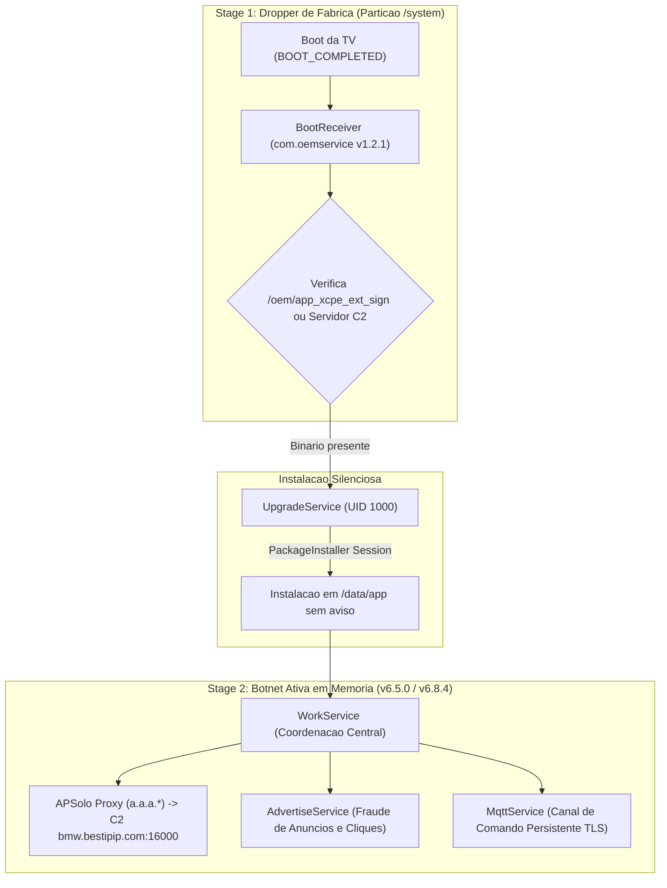

# Relatório Forense: Análise do Malware de Cadeia de Fornecimento XCPE / BadBox (`com.oemservice`)

> **Language / Idioma:** Português (PT-PT) | [For English version, see FORENSIC_XCPE_OEMSERVICE.en.md](FORENSIC_XCPE_OEMSERVICE.en.md)

---

## 1. Sumário Executivo
Durante as auditorias de segurança a dispositivos Android TV / Google TV fabricados com firmwares SkyworthDigital (notavelmente os modelos MECOOL e derivados), foi identificada e analisada uma cadeia de infeção furtiva do tipo **Supply-Chain Attack** (Ataque à Cadeia de Fornecimento).

Este documento detalha a engenharia reversa estática e comportamental realizada sobre o binário de fábrica de primeiro estágio (`app_xcpe_preset.apk` v1.2.1) e o respetivo payload de segundo estágio (`app_xcpe_ext_sign.apk` / `base.apk` v6.5.0), demonstrando como um componente pré-instalado com permissões de sistema (`UID 1000`) atua como vetor de proxy clandestino, fraude de anúncios e execução remota de código.

---

## 2. Anatomia e Fases da Infeção (Infection Lifecycle)

A ameaça opera através de uma arquitetura modular de **duas fases** para contornar verificações superficiais de segurança e testes de fábrica do Google Play Protect:



### Fase 1: O Dropper Adormecido (Stage 1)
* **Localização na ROM:** `/system/priv-app/app_xcpe_preset/app_xcpe_preset.apk`
* **Versão:** `1.2.1` (Compilada para API 30)
* **Privilégios:** `android:sharedUserId="android.uid.system"` (UID 1000)
* **Comportamento:**
  * O manifesto define uma aplicação sem interface gráfica (`Theme.NoDisplay`).
  * Ao arrancar a TV, a intenção de alta prioridade (`priority="1000"`) `android.intent.action.BOOT_COMPLETED` acorda o `x.cpe.receiver.BootReceiver`.
  * O código-fonte do `BootReceiver.java` procura deliberadamente por pacotes com nome `com.oemservice` na partição `/oem/`:
    ```java
    File file = new File("oem");
    if (file.exists() && file.listFiles() != null) {
        // Encontra o payload pre-embutido /oem/app_xcpe_ext_sign
        enterInstallService(context, file2);
    }
    ```
  * O `UpgradeService.java` utiliza a API oculta de sistema `android.content.pm.PackageInstaller` para instalar o novo APK sem consentimento do utilizador nem diálogos no ecrã.

### Fase 2: O Payload da Botnet Ativa (Stage 2)
* **Origem:** `/oem/app_xcpe_ext_sign` (ou descarregado remotamente via C2).
* **Destino de Execução:** `/data/app/~~.../com.oemservice-.../base.apk`
* **Versão Identificada:** `6.5.0.20230804.alpha` (VersionCode 43)
* **Target SDK:** API 28 (Android 9 Pie) — rebaixamento deliberado de API para evitar restrições modernas de background e privacidade do Android 10+.

---

## 3. Análise Detalhada dos Módulos Maliciosos

A descompilação de `app_xcpe_ext_sign` revelou uma estrutura avançada com mais de 7.000 ficheiros e módulos divididos por finalidade:

### 3.1. Proxyware Residencial Clandestino (`APSolo Proxy`)
* **Pacote Obfuscado:** `a.a.a.*`
* **Identificador de Log:** `solo_ProxyLogger`
* **C2 / Relay Endpoint:**
  ```java
  package a.a.a;
  public class a {
      public static final String[] f0a = {"bmw.bestipip.com:16000"};
      public static long b = 24032810102L; // Timestamp de compilacao: 28/03/2024
  }
  ```
* **Mecanismo Técnico (`ae.java`, `c.java`):**
  * Implementa um servidor proxy com recurso a NIO (`java.nio.channels.Selector`, `ByteBuffer` de 4096 bytes).
  * Cria conexões TCP assíncronas reversas para o IP/porta do servidor `bestipip.com:16000`.
  * Encaminha conexões externas da Internet através do endereço IP residencial da vítima, transformando a Android TV num nó de rede proxy comercializado na darkweb ou redes de proxy residencial (estilo botnet BadBox / APSolo).

### 3.2. Fraude de Publicidade Invisível (`AdvertiseService`)
* **Componente:** `x.cpe.service.AdvertiseService`
* **Configuração:** `x.cpe.ServerConfig.java`
* **Campos Extraídos:**
  * `adUse`: ativação global do módulo de publicidade;
  * `adDevourUse` / `adDevourCode = "lx102"`: motor de consumo silencioso de anúncios;
  * `adCode = 200101`: ID de campanha afiliada de monetização;
  * `adBwmActive`: mecanismo de controlo de largura de banda para evitar que a vítima note lentidão excessiva.
* **Técnica Anti-Crash:**
  * Implementa um `ANRWatchDog` interno de 10 segundos: se a renderização oculta de anúncios bloquear o sistema da TV, o serviço termina-se a si próprio silenciosamente para a Google TV não exibir a mensagem *"Aplicação não responde"*.

### 3.3. Comando e Controlo Remoto Persistente via MQTT
* **Componente:** `org.eclipse.paho.android.service.MqttService`
* **Certificado Criptográfico:** `res/raw/cacert.pem`
* **Mecanismo:**
  * Mantém um canal bidirecional TLS permanente com a infraestrutura C2.
  * Permite ao operador enviar comandos arbitrários, ativar/desativar módulos e instruir a box a descarregar outros APKs via `InstallForAndroiP$InstallResultReceiver`.

---

## 4. Indicadores de Compromisso (IOCs) Catalogados

| Tipo | Indicador | Função |
|---|---|---|
| **Domínio / Porta C2** | `bmw.bestipip.com:16000` | Relay de tráfego proxy e comando C2 (v6.5) |
| **Domínios C2 (v6.8.9)** | `extstb.anyevonline.com:8000`, `mcstb.anyevonline.com`, `router.anyevonline.com` | C2 HTTP/MQTT dinâmico descoberto no Stick .144 |
| **Domínios Relacionados** | `rao.bestipip.com`, `song.bestipip.com`, `bestipip.com` | Infraestrutura secundária APSolo / XCPE |
| **Domínios C2 (Google GTIG)** | `zorapslwsnic.com`, `cloudbrokerapi.xyz`, `floporin.com` | Operação global desmontada pela Google Cloud |
| **Pacote Android** | `com.oemservice`, `x.cpe` | Identificador do dropper e do payload |
| **Ficheiro de Fábrica** | `/system/priv-app/app_xcpe_preset/app_xcpe_preset.apk` | Dropper Stage 1 (v1.2.1) |
| **Ficheiro OEM Embutido** | `/oem/app_xcpe_ext_sign` | Payload Stage 2 pré-carregado |
| **UID de Execução** | `1000` (`android.uid.system`) | Privilégios elevados de sistema |

---

## 5. Alinhamento com a Investigação Global da Google Cloud (GTIG)

Esta investigação corrobora diretamente o relatório global publicado pela **Google Cloud Threat Intelligence (GTIG)** em cooperação com a Mandiant, Human Security e a Polícia Nacional do Japão:
* **Relatório Oficial:** [Shutting the Door on the XCPE Botnet (Google Cloud)](https://cloud.google.com/blog/topics/threat-intelligence/shutting-the-door-on-the-xcpe-botnet)
* **Atribuição:** A Google atribuiu formalmente com alta confiança o desenvolvimento e monetização da botnet XCPE à fabricante chinesa **Videostrong Technology Co.** (e respetivas subsidiárias ODM como a Skyworth/MECOOL), que embutiu deliberadamente este backdoor de fábrica em mais de 1,3 milhões de boxes em 200 países.
* **Proibição Google:** Na sequência deste ataque à cadeia de fornecimento, a Google revogou as certificações e baniu a fabricante de produzir novos equipamentos com os serviços móveis Google (GMS).
* **Nossa Verificação Local:** A nossa engenharia reversa sobre a versão `v6.5.0` comprova a presença dos mesmos mecanismos documentados pela Google: o uso de túneis reversos (FRP/NIO), cliente MQTT persistente, fraude de anúncios e a transformação da TV num nó proxy residencial clandestino através de `bestipip.com`.

---

## 5. Medidas de Mitigação e Remediação

Para erradicar completamente a ameaça sem necessidade de desbloqueio de bootloader ou root permanente:

1. **Congelamento Imediato do Pacote via ADB:**
   ```bash
   adb shell pm disable-user --user 0 com.oemservice
   ```
   * *Efeito:* O Android termina instantaneamente todos os processos em execução (`WorkService`, `NetworkService`, `AccessService`) e descarta a atualização em `/data/app`, mantendo o pacote da ROM inerte (`disabled-user`).

2. **Cancelamento de Agendamentos de Persistência:**
   ```bash
   adb shell cmd jobscheduler cancel -u 0 com.oemservice
   ```

3. **Bloqueio de DNS via DoT (DNS-over-TLS):**
   * Configuração de DNS seguro com filtragem de malware ao nível do sistema operativo:
     ```bash
     adb shell settings put global private_dns_mode hostname
     adb shell settings put global private_dns_specifier security.cloudflare-dns.com
     ```
   * Garante que mesmo em caso de reposição do utilizador, as consultas aos domínios `bestipip.com` e C2s de Badbox sejam terminadas à nascença.
